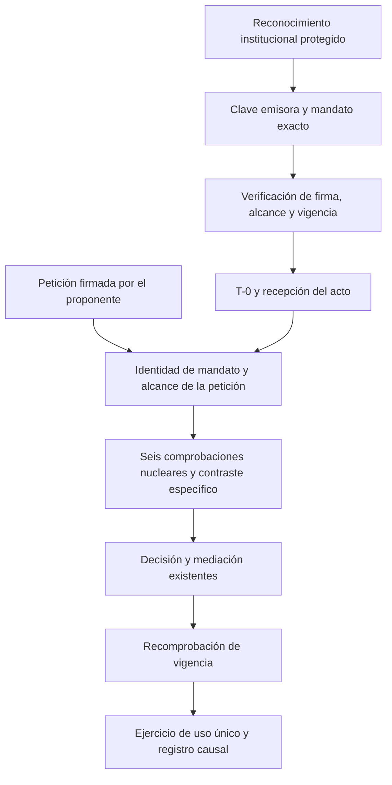

# Admisión institucional: contrato de integración y límites

Fecha: 19/10/2026. Recepción vinculada a S44, TT-0028 y RETP-2026-327. Base: e7e3478c8a2da856451ee3b08c5158ab5dbd68b9.

El componente Rust `institutional-admission` realiza una admisión verificable y la conduce por T-0, las comprobaciones constituidas, la decisión, la mediación y el ejercicio existentes. Es una función opcional, deshabilitada en la configuración predeterminada. No incorpora una ruta de red, una inferencia, una facultad administrativa del Gestor ni una nueva semántica del dominio.

## Autoridad, configuración y petición

La instalación reconoce previamente una clave pública emisora y un mandato exacto. Esa configuración es una operación privilegiada del soporte institucional; no puede proceder de un formulario ordinario, del contenido de una IA ni de un documento presentado por el solicitante. El componente no decide quién tiene legitimidad jurídica para reconocer al emisor. Una firma válida sólo prueba procedencia respecto de la clave que la institución ha reconocido.

`InstitutionalInstallation::configure` es la interfaz de esa configuración privilegiada, no un mecanismo de autenticación de administradores. La biblioteca no puede impedir que un programa que ya controla su propia inicialización elija otra raíz. Antes de instalar esta capacidad, el soporte debe demostrar quién puede configurar, de dónde obtiene la raíz, cómo conserva el acto de reconocimiento y cómo impide su sustitución. No basta con llamar a esta función desde una petición y denominarla privilegiada. Ese enlace institucional y su custodia material siguen pendientes de recepción.

La petición ordinaria no elige raíz, plan, facultades, verificadores, resultados ni referencia de contraste. Declara dominio, contexto, operación, objeto, identificador de invocación y evidencia observada, y debe estar firmada por el proponente autorizado en el mandato. El emisor y el proponente utilizan claves diferentes. Esta separación criptográfica no demuestra por sí sola independencia entre personas o funciones: la institución debe constituir y comprobar sus competencias.

## Mandato y frontera

El mandato fija institución, emisor, dominio, contexto, operación, objeto, edición, identificador, clave del proponente, intervalo de vigencia, contrato de comparación y referencia exacta. Su representación binaria v1 conserva longitudes explícitas; no normaliza ni interpreta de nuevo el contenido firmado. Admisión, petición y revocación tienen prefijos distintos. La huella del mandato liga los resultados a su configuración íntegra, sin convertir la huella en fuente de autoridad.

Se usa `ed25519-dalek` con verificación estricta y rechazo de claves débiles o con representación no admitida. No se incorpora una clave privada de instalación ni una clave de prueba predeterminada. Las pruebas emplean exclusivamente identidades sintéticas. El contrato de comparación exacta comprueba identidad de bytes con la referencia configurada: no acredita verdad médica, suficiencia profesional, cobertura de un universo ni corrección de un consejo.

Los resultados nucleares se calculan sobre el estado recibido: forma válida, autoridad aplicable, pertenencia del objeto gobernado, admisibilidad y aplicabilidad de verificadores, separación de identidades y vigencia sin revocación. Se añade la comparación específica de evidencia. La composición reutiliza resolución, cobertura y mediación del núcleo; no acepta una aprobación nominal del solicitante. La vigencia se comprueba de nuevo antes del efecto mediante reloj civil y límite monotónico. La revocación firmada es irreversible en la instancia y conserva un registro separado, incluso si se agota el registro ordinario.

El adaptador recibe el efecto mediado y exactamente la evidencia contrastada. Su llamada es terminal: un error o un pánico posterior no habilitan repetición. La biblioteca conserva la relación causal; el confinamiento material del adaptador y de sus recursos corresponde a las garantías posteriores de soporte. No se presupone que un adaptador arbitrario cumpla por sí mismo el efecto declarado.

## Recursos, registro y confidencialidad

| Recurso | Límite y conducta |
|---|---|
| Etiqueta | 256 bytes, comprobados antes de recorrer sus caracteres. |
| Mandato serializado | Cota de 65.536 bytes, comprobada antes de copiar. |
| Evidencia de petición | 65.536 bytes; las etiquetas y el encuadre añaden un tamaño también acotado. |
| Registro autenticado | 32 actuaciones por instancia; agotamiento explícito, sin borrado ni repetición automática. |
| Entradas no autenticadas o mal formadas | Contador saturado y último motivo/fecha, sin contenido; no consumen la capacidad autenticada. |
| Admisiones en un proceso | 1.024 mandatos; reserva terminal y rechazo al agotarse. |
| Ejercicio por mandato | Uno; decisión y ejercicio se conservan vinculados. |

Los límites de memoria internos no sustituyen el control de frecuencia de una futura interfaz de red. Un principal autenticado puede agotar su capacidad; el responsable debe conservar la evidencia y resolver el estado, sin reiniciar para recuperar facultades. Las entradas no autenticadas se resumen: no existe un expediente individual durable de cada intento.

Las representaciones de diagnóstico no revelan identidad, claves ni contenido. El acceso explícito a evidencia y trazas es una función de custodia y requiere permisos en el soporte. El componente no escribe en disco ni envía datos. Sus comprobaciones se realizan localmente; no recibe instrucciones de una IA ni accede a un proveedor.

## Dependencias y condiciones de continuación

Esta recepción demuestra el mecanismo intraproceso, incluido un cliente externo de la biblioteca sin constructor de pruebas. No demuestra reconocimiento jurídico del emisor, custodia de la clave de configuración, reloj confiable frente al administrador del soporte, continuidad tras reinicio, revocación entre procesos o confinamiento material. Tampoco reconoce automáticamente el mismo mandato como seguro en otra instalación.

| Función responsable | Pendiente | Criterio de comprobación |
|---|---|---|
| Integración institucional | Reconocimiento protegido, permisos de configuración y custodia del acto. | Una petición ordinaria no puede introducir o cambiar raíz, mandato o competencias; el reconocimiento real queda trazado. |
| Desarrollo y recepción de R2 | Persistencia, consumo, revocación y recuperación. | Una copia anterior, otro proceso o un reinicio no restablecen facultades consumidas o revocadas; se conserva el fundamento y la causa. |
| Desarrollo del soporte y R3 | Confinamiento del adaptador y recursos efectivos. | Efectos, destinatarios y recursos no pueden ampliarse fuera de la mediación. |
| Dominio y verificadores competentes | Cobertura, fidelidad y revisión profesional de la adenda. | Contrastes positivos y adversos por operación, con referencia independiente y evidencia íntegra. |
| Recepción de conjunto | Composición de las capacidades pendientes. | Aceptación del recorrido completo por su alcance; no suma nominal de recepciones parciales. |

Se mantiene el orden documentado de consolidación nuclear y continuación R2. El punto **(P1 + P3)-Bis** conserva sus contratos y condiciones: esta recepción contribuye al control de contenido y autoridad de C09 y a su composición; no cierra C01–C12 ni transforma justificación declarada en evidencia profesional. S44 y TT-0028 continúan en ejecución. Producción, exámenes y entrega de contenido a proveedores permanecen deshabilitados.

© 2026 Juan Antonio Lloret Egea. Algunos derechos reservados. | ORCID: 0000-0002-6634-3351 | Instituto Tecnológico Virtual de la Inteligencia Artificial para el Español™ (ITVIA) | IA eñ™ – La Biblia de la IA™ | ISSN 2695-6411 | Licencia Creative Commons Atribución-NoComercial-SinDerivadas 4.0 Internacional (CC BY-NC-ND 4.0).
