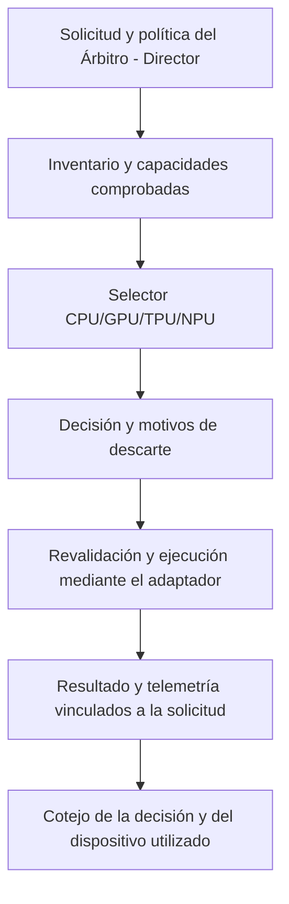

# Selector del Árbitro - Director CPU/GPU/TPU/NPU

El Selector elige un destino de cálculo compatible y disponible para una carga admitida, conforme a la política del Árbitro - Director. Su función es comparar recursos identificados y capacidades comprobadas, conservar la decisión y explicar los descartes. No modifica el núcleo del SV, su semántica ni su representación intermedia.

## Funcionamiento delimitado

1. Recibe una solicitud identificada, una política y un inventario aportados por los componentes responsables.
2. Comprueba destino permitido, clase, residencia, disponibilidad, vigencia, memoria y cobertura de la carga exacta.
3. Elige el menor tiempo total estimado cuando la política solicita esa comparación y todos los candidatos aptos disponen de estimaciones comparables.
4. Si faltan estimaciones, aplica el orden explícito y declara esa limitación; no presenta esa decisión como prueba de superioridad temporal.
5. Devuelve el destino, criterio, referencia de capacidad y motivos de descarte. Los adaptadores revalidan y ejecutan; la observación permite cotejar el destino con el cálculo realizado.

La biblioteca de selección, por sí sola, no descubre hardware, reserva memoria, carga un modelo ni ejecuta sus operaciones. No admite reparto parcial implícito ni traslada una sesión con residencia obligatoria. GPU, TPU y NPU no tienen prioridad automática sobre CPU.

## Comprobaciones físicas documentadas

| Plataforma y carga | Destinos examinados | Resultado |
|---|---|---|
| Kaggle; Qwen3-8B Q4_K_M | [CPU Intel Xeon](../intel/xeon-kaggle-20261014/readme.md) / [GPU NVIDIA T4](../nvidia/tesla-t4/readme.md) | Ocho solicitudes gobernadas: tres CPU y cinco GPU. Las dos automáticas eligieron GPU. |
| Google Cloud; Helsinki-NLP/opus-mt-en-es | [CPU AMD EPYC 7B13](../amd/epyc-7b13/readme.md) / [TPU Google v5e](../google/tpu-v5e/readme.md) | Seis decisiones ejecutadas y dos rechazos lógicos. Las dos automáticas eligieron CPU al medir el recorrido completo instrumentado. |

El contraste Kaggle utilizó un perfil experimental del Árbitro - Director. La realización CPU/TPU conectó el mismo Selector con el adaptador de traducción. No se atribuye a ambos ensayos una integración productiva idéntica.

## Código Rust identificado

La fuente de selección conservada en ambos expedientes es idéntica: SHA-256 `2b6cd91da365f15ab314ea69ef6eeec1b12826ddf0de01fcca58191ef5afff05`.

- [Fuente utilizada en Kaggle](https://github.com/juantoniolloretegea/SV-motor/blob/32239f974af3a6367efd75d36ba984a6c2fc747e/laboratorio/ensayo-ia-y-observabilidad/modelos-de-ia/qwen/qwen3-8b-cuantizacion-q4_k_m-gguf/codigo/gobierno-20261014/selector/src/lib.rs).
- [Fuente utilizada en Google Cloud](https://github.com/juantoniolloretegea/SV-motor/blob/32239f974af3a6367efd75d36ba984a6c2fc747e/laboratorio/ensayo-ia-y-observabilidad/modelos-de-ia/helsinki-nlp/codigo/contraste-cpu-tpu/src/lib.rs).
- [Reproducción del ensayo CPU/GPU](https://github.com/juantoniolloretegea/SV-motor/blob/32239f974af3a6367efd75d36ba984a6c2fc747e/laboratorio/ensayo-ia-y-observabilidad/modelos-de-ia/qwen/qwen3-8b-cuantizacion-q4_k_m-gguf/codigo/gobierno-20261014/REPRODUCCION.md).
- [Reproducción del ensayo CPU/TPU](https://github.com/juantoniolloretegea/SV-motor/blob/32239f974af3a6367efd75d36ba984a6c2fc747e/laboratorio/ensayo-ia-y-observabilidad/modelos-de-ia/helsinki-nlp/codigo/contraste-cpu-tpu/LEAME-SV.md).

Los expedientes conservan las dependencias y licencias de cada adaptador. La selección es Rust; la realización física mantiene dependencias específicas: controlador CUDA y NVML en T4, y PJRT/libtpu en TPU. La identidad del Selector no convierte esas dependencias en Rust.

## Alcance de aplicación

El criterio es que el SV gestione la ejecución de la carga. Comprende la preparación para una futura IA del nodo 1 y motores propios de traducción, incluso cuando apoyen consultas a IAs externas. El Selector no controla los dispositivos internos del proveedor de una IA externa.

Las pruebas acreditan las operaciones y configuraciones descritas. No validan en general el nodo 1 ni todas las GPU, TPU o NPU. GPU AMD, NPU Intel y NPU Qualcomm permanecen pendientes; la categoría NPU declarada en la biblioteca no equivale a ejecución NPU comprobada.

[Volver al catálogo de hardware](../readme.md).

© 2026 Juan Antonio Lloret Egea. Algunos derechos reservados. | ORCID: 0000-0002-6634-3351 | Instituto Tecnológico Virtual de la Inteligencia Artificial para el Español™ (ITVIA) | IA eñ™ – La Biblia de la IA™ | ISSN 2695-6411 | Licencia Creative Commons Atribución-NoComercial-SinDerivadas 4.0 Internacional (CC BY-NC-ND 4.0).

